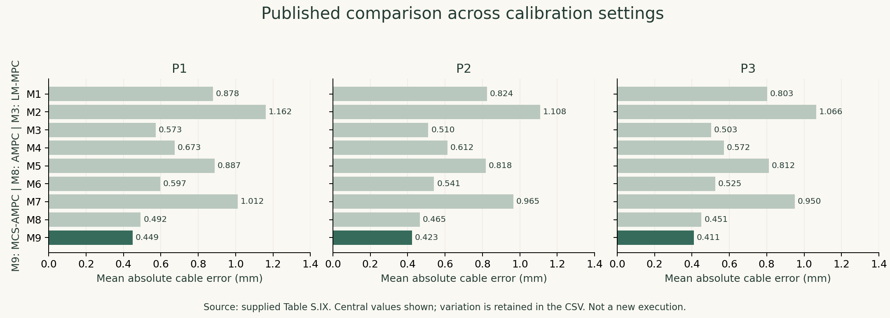
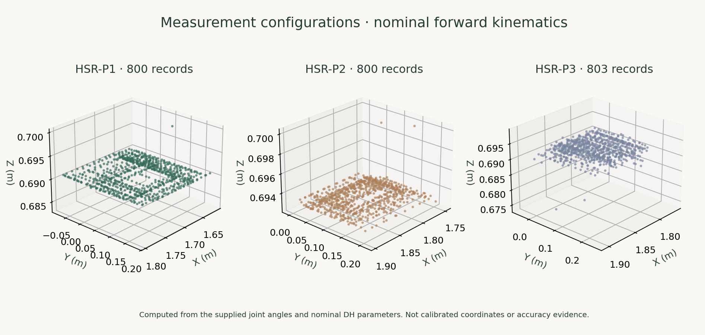

<p align="center"></p>

# Industrial Robot Calibration

**Measurement configuration selection and multi-planar constraints for precise kinematic calibration.**

[Paper](https://doi.org/10.1109/TII.2024.3450112) · [Method](docs/METHOD.md) · [Data notes](docs/DATA.md) · [Run guide](docs/RUNNING.md)

A research portfolio accompanying *An Efficient Industrial Robot Calibrator With Multiplaner Constraints*, published in **IEEE Transactions on Industrial Informatics**. The method combines observability-based measurement configuration selection (MCS) with an alternating direction method of multipliers and multi-planar constraints (AMPC).

| Research focus | Implementation | Experimental setting |
|---|---|---|
| Robot kinematics and constrained optimization | MATLAB | HSR-JR680 robot; three measurement planes |

## The idea

An industrial robot may repeat a movement consistently while still missing its intended absolute position. This work identifies geometric parameter errors using cable-length measurements and contact measurements on multiple planes, including when the usable workspace is constrained.

1. **Select informative measurements.** Evaluate observability and search for a useful subset of robot configurations.
2. **Calibrate one shared robot model.** Jointly estimate DH parameters while retaining separate plane parameters and sensor anchor positions.
3. **Inspect the errors.** Report cable residuals on training and held-out configurations; examine plane residuals and optimization diagnostics separately.

## Published evidence



| Method | P3 mean cable error | P3 cable RMSE |
|---|---:|---:|
| Before calibration | 2.451 mm | 2.562 mm |
| LM with multi-planar constraints (M3) | 0.503 mm | 0.587 mm |
| AMPC (M8) | 0.451 mm | 0.551 mm |
| MCS-AMPC (M9) | **0.411 mm** | **0.502 mm** |

These are **paper-reported central values**, taken from supplied Table S.IX, not results newly obtained from this repository. The CSV in [`results/paper`](results/paper/calibrator_comparison.csv) retains the reported variation. On P3, AMPC reduces mean error by approximately **10.34%** relative to LM-MPC (0.503 → 0.451 mm); MCS-AMPC reduces it further to 0.411 mm. These cable residuals do not by themselves establish a full six-dimensional pose accuracy.

## Explore the measurements



The supplied workbook contains **800 / 800 / 803 valid measurements** across HSR-P1 / HSR-P2 / HSR-P3. The paper describes 800 per plane; the additional three P3 rows remain untouched. The diagram above is computed from joint angles and nominal DH parameters, not a calibrated reconstruction.

The supplied preselected workbook contains **100 configurations per plane**. Exact matching across all eight columns confirms that all 300 records belong to the corresponding raw plane. The default calibration entry point uses this supplied selection; the optional selector creates a separate regenerated workbook. See [the audit](docs/DATA.md).

## Run in MATLAB

Use **MATLAB R2020a or newer** as the targeted environment (`readmatrix`, `sheetnames`, `writecell`, `tiledlayout`, `exportgraphics`). No external robotics toolbox is called by the curated entry points. **The MATLAB solver has not been executed in this preparation environment**; runtime and convergence still require verification in MATLAB.

Open this project folder as the MATLAB Current Folder, then run:

```matlab
% Joint calibration on the supplied 100-per-plane selection.
% Seeded 80/20 split within each selected plane.
run('matlab/calibration/mainMultiplaner.m')
```

The script saves training/test CSVs, a MAT checkpoint with split row indices, and training curves under `outputs/`.

To explore or regenerate the selection, run each command separately:

```matlab
% Optional observability sweep.
run('matlab/selection/mainObservabilityIndex.m')
% Optional seeded DE selection: 150 generations per plane; can take time.
run('matlab/selection/mainO60.m')
```

The optional selector creates `data/selected/HSR-P_DE_top100.xlsx` and `selection_provenance.mat`. To calibrate on it, change `provided_selection` to `selected` in the calibration script's `dataFile` setting. The selector uses Excel rows A201:H400 as its candidate window; it does not search every supplied record.

For the standalone MATLAB kinematics check:

```matlab
run('matlab/tests/check_kinematics.m')
```

This check is provided for local execution and has **not** been run here. [Detailed instructions and limitations →](docs/RUNNING.md)

## Inside this repository

| Location | Contents |
|---|---|
| `matlab/selection/` | Observability sweep, seeded DE configuration selection, analytic Jacobian |
| `matlab/calibration/` | Shared-parameter multi-plane solver, single-plane comparison, kinematics helpers |
| `data/raw/` | Unmodified source workbook |
| `data/provided_selection/` | Supplied 100-per-plane selection, matched to raw records |
| `results/audit/` | Actual record counts and row-level selection matching |
| `results/paper/` | Transcribed published comparison, explicitly labelled |
| `paper/` | Supplied paper, supplement and experimental tables |
| `reference/` | Byte-identical supplied MATLAB scripts for provenance |
| `docs/` | Method, data, runtime instructions and preparation checks |

## Publication

Tinghui Chen, Weiyi Yang, Zhetao Zhang, and Xin Luo. **An Efficient Industrial Robot Calibrator With Multiplaner Constraints.** *IEEE Transactions on Industrial Informatics*, 2024 (supplied early-access version). DOI: [10.1109/TII.2024.3450112](https://doi.org/10.1109/TII.2024.3450112).

The paper bibliography retains the original authorship. This repository packages the supplied research materials; no new software or dataset license is asserted. Consult the original publication terms for redistribution and reuse.

## Maintainer

**[Zhetao Zhang](https://github.com/ZhetaoZhang998)**
